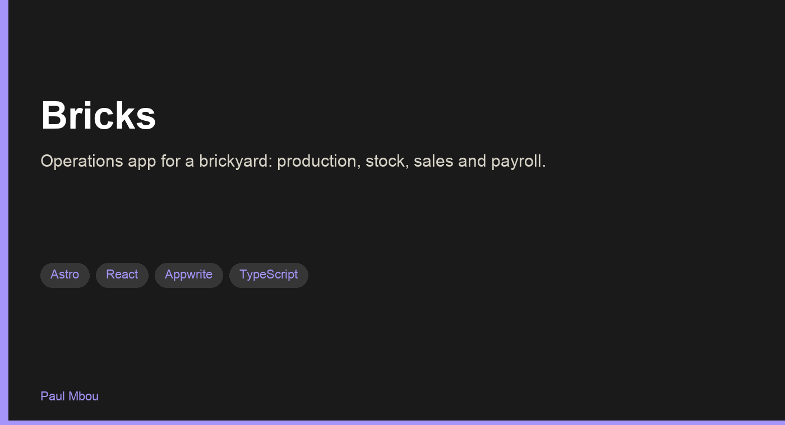

# Bricks

**Operations software for a brickyard.**
Production, stocks, approvisionnement, ventes, énergie, paie, partenaires et récaps — avec un mode démonstration si Appwrite n’est pas configuré.



Application de gestion de briqueterie (Astro + React + Appwrite).

## Démarrage

```bash
cp .env.example .env   # renseigner le projet Appwrite Cloud
npm install
npm run dev
```

Sans variables Appwrite, la connexion ouvre le **mode démonstration** local (sessionStorage).

## Scripts

| Commande | Rôle |
|----------|------|
| `npm run dev` | Serveur de développement |
| `npm test` | Vitest — règles de calcul `packages/domain` |
| `npm run check` | Astro + TypeScript |
| `npm run build` | Build SSR (adapter Vercel) |
| `npm run deploy` | Déploiement production Vercel |
| `npm run test:e2e` | Playwright (parcours clés) |

## Design system

Porté de **gold_stock** (shell, `ui.tsx`, theme, bottom nav) avec tokens **slate / clay** — palette soft lavande / charbon / lime :

- Surfaces : canvas `#f4f3f8`, panel blanc, ink charbon `#1a1a1a`
- Accent marque (`clay`) : lavande `#a594f9` / `#8b7cf7`
- CTA principal (`btn-slate`) : charbon ; highlight succès : lime `#d7ff77`
- Modales : centrées + blur ; formulaires longs en panneau droit (`sheet`)
- Démo : visite spotlight rejouable (Paramètres → Relancer la présentation)

## Appwrite

- Schéma collections : [`appwrite/collections.json`](appwrite/collections.json)
- Functions mutations / cron : `appwrite/functions/`
- SDK client : `appwrite` · serveur : `node-appwrite` (versions dans `package.json`)
- Push propriétaire : Appwrite Messaging + FCM (Android PWA). Tester app fermée / économie batterie sur le téléphone réel ; documenter le résultat ici.

### Test push (à compléter sur device réel)

| Condition | Résultat |
|-----------|----------|
| App ouverte | — |
| App en arrière-plan | — |
| App fermée / écran verrouillé | — |
| Économie de batterie | — |

Si la livraison PWA n’est pas fiable : enveloppe Capacitor pour le propriétaire seul.

## Architecture

- Domaine pur : `packages/domain`
- Store démo + règles métier locales : `src/lib/store.ts` (remplacé progressivement par Functions live)
- Offline queue idempotente : `src/lib/offlineQueue.ts`

## Licence

Propriétaire — usage client.
